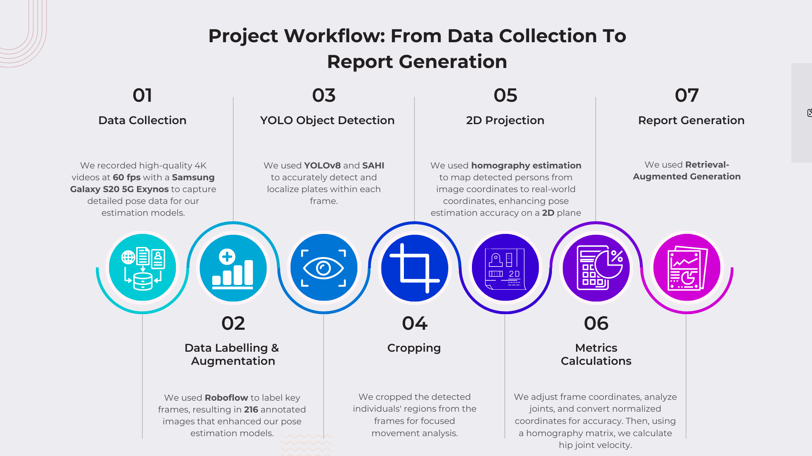
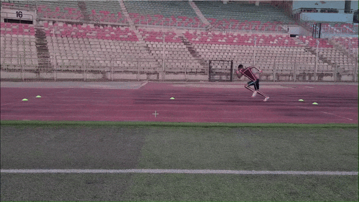
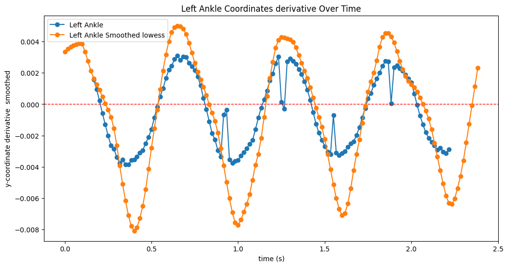

# Human Pose Estimation in Sport Analysis

This research project analyzes sprint videos using person detection, athlete
tracking, pose estimation, ground-marker calibration, and instantaneous velocity
estimation. It was originally developed in 2023–2024 and reorganized in 2026 so
the original research can be understood and resumed without replacing its
algorithms.

## Current capabilities

- Detect people with the standard YOLOv8s model.
- Associate detections using the prototype's bounding-box proximity tracker.
- Select the athlete with the greatest horizontal displacement.
- Run MediaPipe Pose on athlete-centred frame crops.
- Detect five ground calibration markers with a custom YOLOv8 model and SAHI.
- Compute an image-to-ground-plane homography for a 10 m × 1.22 m area.
- Transform the left-hip trajectory and estimate instantaneous velocity.
- Plot the velocity time series and export it as JSON.

Joint-angle and stride-length analysis are research goals shown in the original
documentation, but they are not implemented in the current end-to-end pipeline.

## Installation

Python 3.11 is recommended because the original notebooks were developed in a
Python 3.11 environment and several computer-vision packages do not support
Python 3.14.

```powershell
py -3.11 -m venv .venv
.venv\Scripts\Activate.ps1
python -m pip install --upgrade pip
python -m pip install -e .
```

The recorded 2024 versions of NumPy, OpenCV, pandas, Matplotlib, Ultralytics,
and SAHI are preserved in `requirements.txt`. MediaPipe and Statsmodels use
compatible version ranges because their exact historical versions were not
recorded.

## Run the pipeline

From the repository root:

```powershell
python -m sport_analysis data/samples/20240608_195713.mp4
```

For a headless run without OpenCV or Matplotlib windows:

```powershell
python -m sport_analysis data/samples/20240608_195713.mp4 --no-display
```

To choose an output file:

```powershell
python -m sport_analysis data/samples/20240608_195713.mp4 --output outputs/my_run.json
```

The compatibility launcher `python scripts/run_pipeline.py ...` accepts the
same arguments after the package has been installed.

The installed `sport-analysis ...` console command is also equivalent.

The default output is `outputs/velocity.json`. Full inference is computationally
expensive on CPU because YOLO runs for every video frame and SAHI performs sliced
ground-marker inference.

## Project structure

```text
configs/                 Historical training configuration
data/samples/            Original sample sprint videos
docs/                    Architecture, recovery guide, report, and assets
experiments/legacy/      Preserved prototypes and incomplete experiments
models/                  Trained model weights
notebooks/               Preserved research notebooks
outputs/                 Example and generated results
scripts/                 Thin command-line launcher
src/sport_analysis/      Maintained application package
tests/                   Lightweight numerical regression tests
```

See [Architecture](docs/ARCHITECTURE.md), [Codebase Guide](docs/CODEBASE_GUIDE.md),
and [Refactoring Report](docs/REFACTORING_REPORT.md) for the complete recovery
documentation.

## Known research assumptions

To avoid changing past numerical results, the reorganization preserves:

- the fixed 60 FPS rate;
- the fixed hip Y coordinate of 1060 pixels;
- right-to-left marker role assignment;
- the simple proximity-based tracker;
- the original 10 m × 1.22 m calibration plane;
- the original velocity formula.

These assumptions should be validated before treating results as production-grade
biomechanical measurements.

## Original visual results






